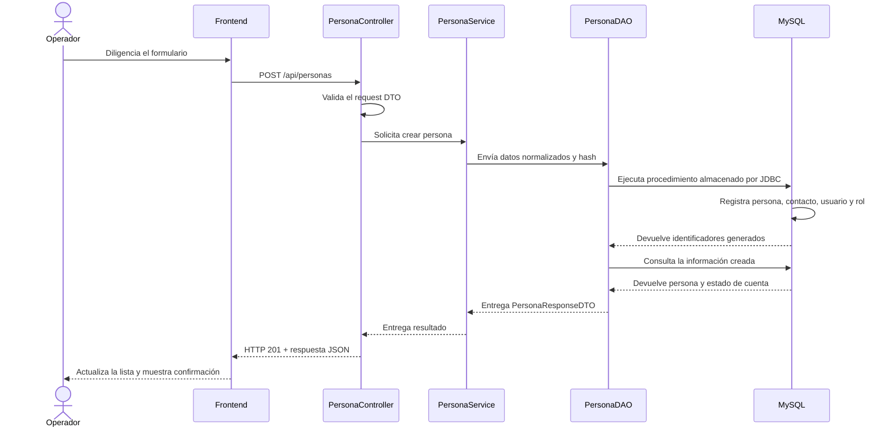

# Flujo de datos: creación de una persona

## 1. Descripción

El registro de una persona integra la información del participante, su contacto de emergencia y su cuenta de acceso. El proceso se ejecuta desde el frontend y atraviesa las capas de la aplicación hasta completar una operación transaccional en MySQL.

## 2. Flujo general

## 3. Etapas del proceso

### 3.1 Captura de información

El formulario de personas recibe los datos básicos del participante y del contacto de emergencia. El frontend realiza validaciones de formato y prepara el cuerpo JSON de la solicitud.

### 3.2 Recepción y validación

`PersonaController` recibe la solicitud `POST /api/personas` y utiliza Bean Validation sobre `CrearPersonaRequestDTO`. Después delega la operación a `PersonaService`.

### 3.3 Reglas de negocio

`PersonaService` normaliza los datos, verifica la disponibilidad del documento y del correo, determina el origen del registro y prepara la información de seguridad de la cuenta.

Para los registros administrativos, la cuenta se relaciona con el participante y se asigna el rol `MIEMBRO` según la configuración del sistema.

### 3.4 Persistencia transaccional

`PersonaDAO` utiliza JDBC puro y ejecuta el procedimiento `sp_crear_persona_con_contacto` mediante `CallableStatement`. El procedimiento coordina las inserciones relacionadas:

1. Registro de la persona.
2. Registro del contacto de emergencia.
3. Creación de la cuenta de usuario.
4. Asociación del rol correspondiente.
5. Confirmación de la transacción.

La operación se ejecuta de forma atómica para conservar la consistencia entre las entidades relacionadas.

### 3.5 Construcción de la respuesta

Después de completar la operación, el DAO consulta la información creada y la vista de estado de cuenta. El mapper transforma el resultado en `PersonaResponseDTO`.

El controller responde con una estructura JSON que contiene el código de operación, el mensaje, la información de la persona y la fecha de respuesta.

### 3.6 Actualización de la interfaz

El frontend recibe la respuesta, actualiza la tabla de personas y presenta la confirmación de registro al operador.

## 4. Flujo de autorregistro

El autorregistro utiliza el mismo modelo de persistencia y las mismas capas de la aplicación. La diferencia se encuentra en el formulario de entrada y en el origen asignado al registro:

1. La persona diligencia sus datos y define su contraseña.
2. El frontend envía la solicitud a `POST /api/personas/autoregistro`.
3. El controller valida `AutoregistroPersonaRequestDTO`.
4. El service cifra la contraseña y marca el origen `AUTOREGISTRO`.
5. El DAO ejecuta el procedimiento transaccional.
6. El sistema crea la persona, el contacto y la cuenta de acceso.

## 5. Flujo de datos por componente

| Componente | Entrada | Proceso | Salida |
| --- | --- | --- | --- |
| Frontend | Datos del formulario | Validación y serialización JSON | Solicitud HTTP |
| Controller | Request DTO | Validación y delegación | Llamada al service |
| Service | Datos validados | Reglas de negocio y seguridad | Datos normalizados |
| DAO | Datos normalizados | JDBC, SQL y procedimientos | Entidad o DTO |
| MySQL | Parámetros JDBC | Transacción y reglas relacionales | Registros e identificadores |
| Mapper | Resultado SQL | Conversión de datos | Response DTO |
| Frontend | Respuesta JSON | Actualización de la vista | Confirmación al usuario |

## 6. Resultado del proceso

Al finalizar el flujo, el sistema cuenta con un registro integral compuesto por la persona, su información de contacto, su cuenta de usuario, el rol correspondiente y la información necesaria para consultar su estado de cuenta dentro del módulo de Aeróbicos.
